# Domain Model

Owner: CTO with Enterprise Business Analyst · Status: v0.2 Phase 0 blueprint (2026-11-16)

This document is the single source for **which domain owns which business entity**, the business rules and the state machines. Every other document (SRS, DATABASE, API) refers to it. If two documents disagree, this one wins until it is corrected through an ADR.

Priority: **P0** = required for the MVP release (R1). **P1** = release R2. **P2** = later. See [PRD.md](PRD.md) §9.

---

## 0. Cross-domain conventions

### 0.1 Ubiquitous language

Terms that sound alike but mean different things. Use these exact words in code, UI and documentation.

| Term | Means | Is not |
|---|---|---|
| **User** | A login identity (email + credentials). Global; can belong to several organizations. | An employee |
| **Membership** | A user's access to one organization, carrying roles. | A team membership |
| **Employee** | An HR record of a person working for the organization. May or may not have a membership. | A user |
| **Platform operator** | A staff member of the OmniTrack provider. Separate principal; no tenant access by default. | An organization owner |
| **Candidate** | A person in the recruitment database of one organization. | A candidate account |
| **Candidate account** | A candidate's portal login for one organization. | A user |
| **Lead** | An unqualified prospect not yet worth a deal. | A contact or a deal |
| **Account** | A company the organization sells to (prospect or customer). Shown in UI as "Customer" once it has a won deal. | A user account |
| **Contact** | A person at an account. | A lead |
| **Deal** | A specific sales opportunity with a value, moving through a pipeline. | A lead |
| **Interaction** | A logged sales touchpoint: call, email, meeting or note. | An audit event or a daily-report entry |
| **Daily report** | An employee's own end-of-day summary of work, reviewed by a manager. | Automatic activity monitoring (out of scope) |
| **Audit event** | An immutable system record of a security- or business-relevant action. | An interaction |
| **Job opening** | An internal hiring need, optionally published on the careers page. | A job posting on an external board (P2) |
| **Application** | One candidate applying to one job opening. | A candidate |

### 0.2 Person references

- Columns meaning *who did it* (`created_by`, `updated_by`, `actor_user_id`) reference **users**.
- Columns meaning *who owns or is responsible for it* (`owner_employee_id`, `assignee_employee_id`, `manager_employee_id`) reference **employees**, because reporting lines, teams and departments hang off employees.
- Rule: every **active membership is linked to exactly one employee** of the same organization. When an admin invites a person who has no employee record, a minimal employee record is created in the same transaction. An employee can exist without a membership (for example someone who never logs in).

### 0.3 Permission scopes

Every permission is granted with one scope. The policy of each resource defines what "own" means for it.

| Scope | Records visible |
|---|---|
| `own` | Records where the actor's employee is owner, assignee, subject or creator (defined per resource) |
| `team` | `own` + records of employees who are members of teams the actor leads |
| `department` | `team` + records of employees in departments the actor heads, including sub-departments |
| `organization` | All records in the organization |

A broader scope always includes narrower ones. Scope is resolved on the server from the actor's employee ID, led team IDs and headed department subtree. These are cached per membership and invalidated on any structure change.

### 0.4 Cross-domain interaction rules

1. A domain writes only to its own tables.
2. A domain reads another domain's data through that domain's exported service, never its tables.
3. When a domain must react to another's change after commit, it does so through a **domain event** delivered by the transactional outbox.
4. When a workflow needs atomic changes in two domains (for example lead conversion or hire), the **initiating domain's service** opens the transaction and calls the other domain's service *within the same transaction*. These are listed explicitly as transaction boundaries in [DATABASE.md](DATABASE.md) §8.

### 0.5 Domain map

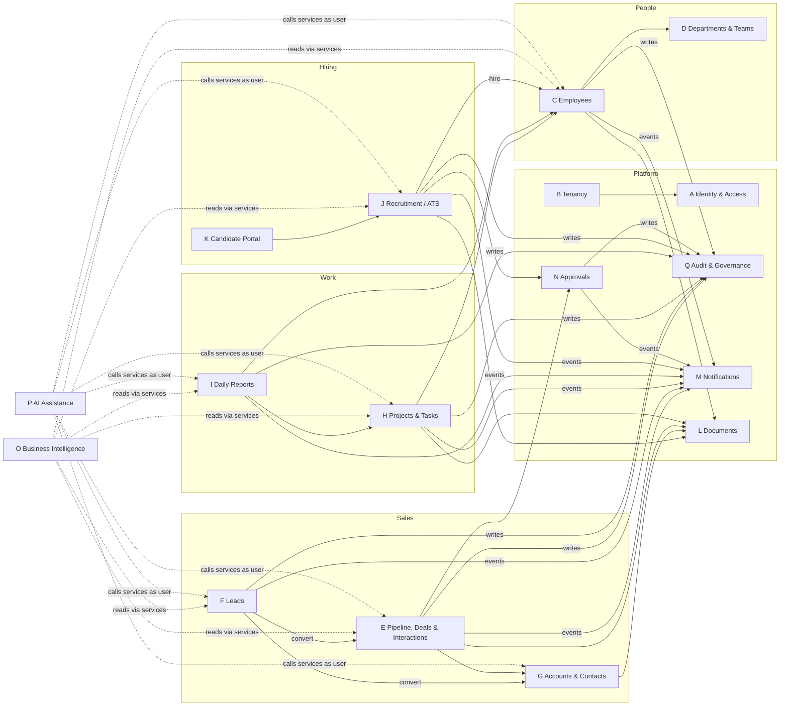

### 0.6 Common error cases (apply to every domain)

| Case | Response |
|---|---|
| Not authenticated / session revoked | 401 `UNAUTHENTICATED` |
| Record belongs to another organization or outside the actor's scope | 404 `NOT_FOUND` (never 403, never reveals existence) |
| Record visible but action not permitted | 403 `FORBIDDEN` |
| Invalid input | 422 `VALIDATION_FAILED` with field errors |
| Business rule violated | 422 with a rule-specific code, listed per domain below |
| Stale `version` on update | 409 `VERSION_CONFLICT` |
| Duplicate unique value | 409 `DUPLICATE` with the conflicting field |
| Invalid state transition | 409 `INVALID_TRANSITION` with current state and allowed transitions |

---

## A. Identity and access management

**Scope.** Authentication of all three principal types (user, platform operator, candidate account), sessions, MFA, password lifecycle, roles and permissions. Does not own organizations or memberships (domain B).

**Actors.** All users, platform operators, candidates, organization owner/admin (role management).

**Entities.** `User`, `MfaFactor`, `Session`, `RefreshToken`, `PasswordResetToken`, `EmailVerificationToken`, `PlatformOperator`, `CandidateAccount`, `CandidateLoginCode`, `Permission` (system catalog), `Role`, `RolePermission`, `MembershipRole`.

**Business rules.**
- A-R1 User email is globally unique, case-insensitive.
- A-R2 Passwords: minimum 12, maximum 128 characters; screened against a breached-password list; Argon2id hashed. No composition rules, no forced periodic rotation (NIST SP 800-63B).
- A-R3 Sign-in throttling: after 5 failed attempts for an account within 15 minutes, each further attempt waits progressively (1 s doubling to 60 s); after 20, the account is soft-locked for 15 minutes. Per IP: 100 attempts per 15 minutes. The response for unknown email, wrong password and locked account is identical.
- A-R4 A session belongs to exactly one organization. Switching organization ends the current session and creates a new one.
- A-R5 Access token: 15 minutes. Refresh token: rotating, 12 hours idle timeout, 30 days absolute. Reuse of a rotated refresh token revokes the whole session.
- A-R6 Deactivating a membership, disabling a user, resetting a password or removing MFA revokes affected sessions immediately (≤ 60 seconds to take effect across all instances).
- A-R7 Platform operators must use TOTP MFA; their sessions last at most 8 hours and they cannot see tenant business data unless an organization owner grants time-boxed support access (P1).
- A-R8 Candidates sign in with a one-time 6-digit email code (10-minute expiry, 5 attempts, single use). No passwords for candidates (ADR-013).
- A-R9 Permissions are a fixed, code-defined catalog. Organizations cannot create permissions, only roles.
- A-R10 Built-in roles cannot be deleted or have permissions removed; they can be copied into custom roles.
- A-R11 Anti-escalation: an actor can only assign a role, or add a permission to a role, if the actor holds every permission in it at an equal or broader scope.
- A-R12 A role assigned to any membership cannot be deleted (409 `ROLE_IN_USE`).
- A-R13 Permission changes apply on the next request (permission cache invalidated by a per-membership version counter).

**State transitions.**

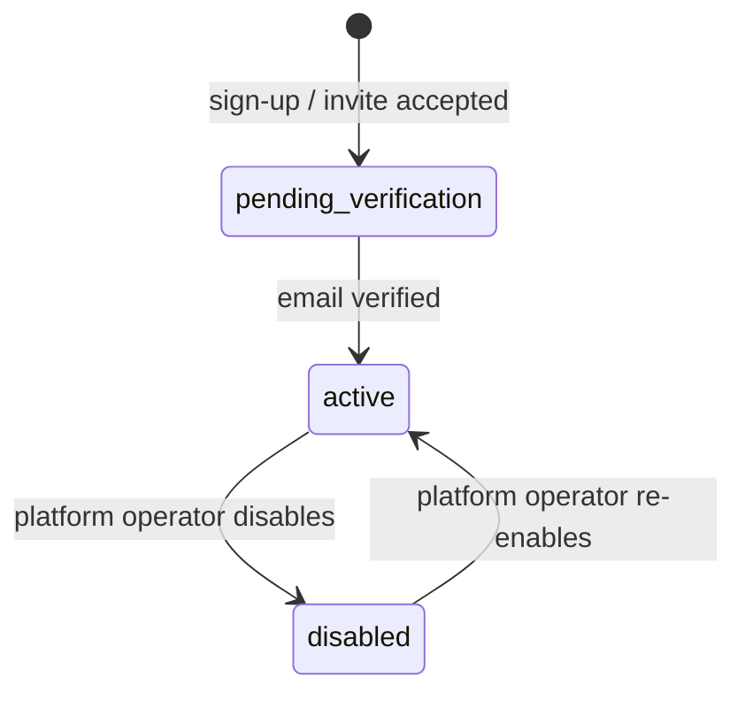

Session: `active → revoked | expired`. Refresh token: `active → rotated` (reuse of a `rotated` token → session `revoked`).

**Dependencies.** B (membership and organization status checked on every sign-in and refresh), Q (security events), M (password reset and new-device emails).

**APIs.** `POST /auth/login`, `/auth/mfa/verify`, `/auth/refresh`, `/auth/logout`, `/auth/switch-organization`, `/auth/password/forgot`, `/auth/password/reset`, `/auth/email/verify`; `GET /me`, `PATCH /me`, `POST /me/password`, `/me/mfa/totp` (enrol, confirm, delete); `GET /me/sessions`, `DELETE /me/sessions/{id}`; `GET /permissions`; `GET|POST /roles`, `GET|PATCH|DELETE /roles/{id}`; `PUT /members/{id}/roles`. Candidate: `POST /portal/{orgSlug}/auth/code`, `/portal/{orgSlug}/auth/verify`, `/portal/auth/logout`.

**Permissions.** `role.read`, `role.manage`, `member.roles.assign`.

**Error cases.** `INVALID_CREDENTIALS` (401, generic), `MFA_REQUIRED` (401 with challenge ID), `MFA_INVALID` (401), `RATE_LIMITED` (429 with `Retry-After`), `REFRESH_REUSED` (401, session revoked), `PASSWORD_BREACHED` (422), `ROLE_IN_USE` (409), `ESCALATION_DENIED` (403), `BUILT_IN_ROLE_IMMUTABLE` (422), `ORGANIZATION_SUSPENDED` (403 at sign-in).

**Acceptance criteria.**
- AC-A1 Sign-in with correct credentials returns session cookies; wrong password, unknown email and locked account produce byte-identical response bodies and statuses.
- AC-A2 Reusing a rotated refresh token revokes the session; the next request with its access token fails within 60 seconds.
- AC-A3 A user with `role.manage` at organization scope but without `employee.sensitive.read` cannot create a role containing `employee.sensitive.read`.
- AC-A4 Removing a permission from a role makes the next API call by an affected member fail with 403/404 as appropriate.
- AC-A5 A candidate session cannot call any non-portal endpoint (401).

---

## B. Multi-tenant organization management

**Scope.** Organization lifecycle, settings, memberships, invitations, platform-level administration.

**Actors.** Platform operator, organization owner, organization admin.

**Entities.** `Organization`, `OrganizationSettings`, `Membership`, `Invitation`, `OrgCounter` (per-organization sequences), `PicklistValue` (tenant-configurable value lists).

**Business rules.**
- B-R1 Organization `slug` is globally unique, 3–40 characters `[a-z0-9-]`, used in the careers URL; changeable at most once per 30 days with the old slug redirecting for 90 days.
- B-R2 Every organization has at least one active owner. Removing, demoting or deactivating the last owner fails with `LAST_OWNER`. Ownership transfer requires the target to be an active member and confirmation by the current owner's password or MFA.
- B-R3 Invitations: single use, token stored hashed, expire after 7 days, revocable. Inviting an email that already has an active membership fails with `ALREADY_MEMBER`.
- B-R4 A suspended organization: all sessions revoked; sign-in refused with `ORGANIZATION_SUSPENDED`; careers page returns 404; scheduled jobs paused. Data is kept.
- B-R5 Closing an organization (owner only, confirmed with password + typed slug) starts a 30-day grace period during which the owner can cancel or export. After grace, data is purged by a job and the purge is recorded in the platform audit log.
- B-R6 Organization settings hold: time zone, locale, currency, working days, daily-report cutoff time, MFA requirement (P1), careers page content, data retention overrides within allowed bounds.
- B-R7 Platform operators can create, suspend, reactivate and view usage metrics of organizations, but not read tenant business records (A-R7).
- B-R8 Seat and storage limits per plan are enforced (P2; billing out of scope for R1 and R2).

**State transitions.**

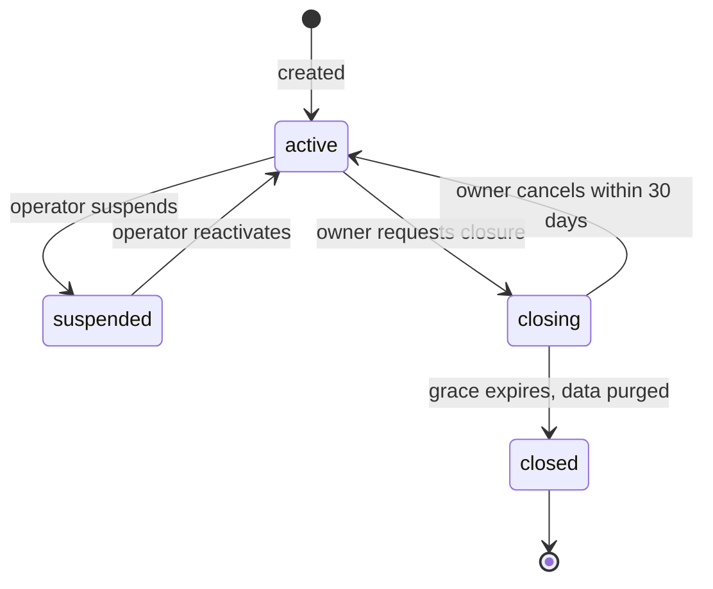

Membership: `invited → active → deactivated → active`. Invitation: `pending → accepted | revoked | expired`.

**Dependencies.** A (users and sessions), C (employee record auto-created for a new member), Q, M (invitation emails).

**APIs.** `POST /platform/organizations`, `GET /platform/organizations`, `POST /platform/organizations/{id}/suspend|reactivate`; `GET|PATCH /organization`, `GET|PATCH /organization/settings`, `POST /organization/close`, `POST /organization/close/cancel`, `POST /organization/transfer-ownership`; `GET /members`, `GET /members/{id}`, `POST /members/{id}/deactivate|reactivate`; `GET|POST /invitations`, `DELETE /invitations/{id}`, `POST /invitations/{token}/accept` (public); `GET|POST /picklists/{listKey}/values`, `PATCH /picklists/{listKey}/values/{id}`.

**Permissions.** `organization.read`, `organization.update`, `member.read`, `member.invite`, `member.deactivate`, `settings.picklist.manage`. Closing and ownership transfer: owner role only (not grantable).

**Error cases.** `LAST_OWNER` (422), `ALREADY_MEMBER` (409), `INVITATION_EXPIRED` / `INVITATION_REVOKED` (410), `SLUG_TAKEN` (409), `SLUG_CHANGE_TOO_SOON` (422), `ORGANIZATION_CLOSING` (409 for writes during grace, except export and cancel).

**Acceptance criteria.**
- AC-B1 A user of organization A requesting any resource ID of organization B receives 404 — verified for every tenant-scoped route by the isolation suite.
- AC-B2 Accepting an invitation creates membership + employee record (if missing) + role assignment atomically; failure of any part leaves no partial records.
- AC-B3 Suspending an organization logs out all its members within 60 seconds.
- AC-B4 Deactivating the last owner fails with `LAST_OWNER`.

---

## C. Employee management

**Scope.** The HR record of each employee: identity, job, reporting line, employment status, sensitive personal details, employment history. Payroll, leave and attendance are out of scope.

**Actors.** HR manager (full), organization admin, department head and team leader (read within scope), employee (own profile, limited self-edit).

**Entities.** `Employee`, `EmployeePersonalDetails` (sensitive, 1:1), `EmploymentEvent` (effective-dated history).

**Business rules.**
- C-R1 `employee_code` unique per organization; auto-generated from a configurable prefix and counter (e.g. `EMP-00042`) unless entered manually.
- C-R2 `work_email` unique per organization when present.
- C-R3 Reporting line: `manager_employee_id` must be an active (or notice-period) employee of the same organization; cannot be self; cannot create a cycle (checked on write by walking up the chain; maximum depth 15).
- C-R4 Every employee has exactly one primary department (domain D).
- C-R5 Changes to department, manager, job title, employment type or status write an `EmploymentEvent` with an effective date, in the same transaction.
- C-R6 Exiting an employee requires: exit date ≥ join date; reassignment of active direct reports; reassignment (or explicit acknowledgement) of open tasks, open leads and open deals. On the exit date a scheduled job sets status `exited` and deactivates the linked membership.
- C-R7 Sensitive personal details (date of birth, personal email and phone, address, emergency contact, government ID numbers) are readable only with `employee.sensitive.read`. Government ID numbers are stored encrypted at application level and displayed masked except to `employee.sensitive.update` holders on explicit reveal, which is audited.
- C-R8 An employee may edit their own phone, personal contact details, emergency contact and profile photo; everything else is HR-managed.
- C-R9 Employee records are never hard-deleted once `active`; only `pre_joining` records created in error can be deleted.

**State transitions.**

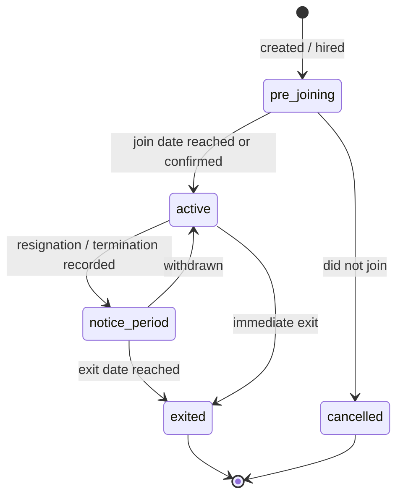

**Dependencies.** D (department), B (membership link), J (hire creates employee), H/E/F (reassignment on exit), L (employee documents), Q, M.

**APIs.** `GET|POST /employees`, `GET|PATCH /employees/{id}`, `GET|PATCH /employees/{id}/personal-details`, `POST /employees/{id}/reveal-government-id`, `GET /employees/{id}/history`, `POST /employees/{id}/notice`, `POST /employees/{id}/exit`, `POST /employees/{id}/activate`, `GET /employees/{id}/direct-reports`, `GET /org-chart`, `GET|PATCH /me/employee`.

**Permissions.** `employee.read`, `employee.create`, `employee.update`, `employee.exit`, `employee.sensitive.read`, `employee.sensitive.update`, `employee.export` (P1). "Own" = the employee record linked to the actor.

**Error cases.** `MANAGER_CYCLE` (422), `MANAGER_INACTIVE` (422), `HAS_ACTIVE_REPORTS` (422 with list), `OPEN_WORK_NOT_REASSIGNED` (422 with counts), `EXIT_BEFORE_JOIN` (422), `CANNOT_DELETE_ACTIVE` (422).

**Acceptance criteria.**
- AC-C1 Setting A's manager to B when B reports (directly or indirectly) to A fails with `MANAGER_CYCLE`.
- AC-C2 A team leader sees employees of teams they lead and nobody else; personal details are absent from responses unless `employee.sensitive.read` is held.
- AC-C3 Changing department writes exactly one `EmploymentEvent` and one audit event.
- AC-C4 On the exit date, the linked membership is deactivated and its sessions revoked by the scheduled job.

---

## D. Departments and teams

**Scope.** Organizational structure: department hierarchy and working teams.

**Actors.** Organization admin, HR manager (manage); everyone (read the structure).

**Entities.** `Department`, `Team`, `TeamMember`.

**Business rules.**
- D-R1 Departments form a tree (`parent_department_id`), maximum depth 6, no cycles. Department `code` and name unique among siblings... code unique per organization.
- D-R2 A department has at most one head (`head_employee_id`), who must be an active employee; the head need not be a member of that department.
- D-R3 A department with employees, child departments or teams cannot be deleted; it can be archived only when it has no active employees and no active child departments.
- D-R4 A team belongs to exactly one department, has exactly one leader (active employee) and any number of members. An employee can belong to multiple teams.
- D-R5 The team leader is implicitly a member.
- D-R6 Every structural change invalidates the scope cache (§0.3) for affected memberships.

**State transitions.** Department and team: `active ⇄ archived`.

**Dependencies.** C.

**APIs.** `GET|POST /departments`, `GET|PATCH /departments/{id}`, `POST /departments/{id}/archive|restore`, `GET /departments/tree`; `GET|POST /teams`, `GET|PATCH /teams/{id}`, `POST /teams/{id}/archive|restore`, `GET|POST /teams/{id}/members`, `DELETE /teams/{id}/members/{employeeId}`.

**Permissions.** `department.read`, `department.manage`, `team.read`, `team.manage`. A team leader may add and remove members of their own team with `team.manage` at `team` scope.

**Error cases.** `DEPARTMENT_CYCLE`, `DEPTH_EXCEEDED`, `DEPARTMENT_NOT_EMPTY`, `LEADER_INACTIVE` (all 422).

**Acceptance criteria.**
- AC-D1 Moving a department under its own descendant fails with `DEPARTMENT_CYCLE`.
- AC-D2 After adding employee X to team T, T's leader can read X's tasks and daily reports on the next request.

---

## E. CRM: pipeline, deals and interactions

**Scope.** The sales pipeline (configurable stages), deals, logged interactions and sales targets. Lead capture is domain F; companies and people are domain G.

**Actors.** Sales executive (own deals), sales manager (team/department deals, pipeline configuration), organization admin.

**Entities.** `Pipeline`, `PipelineStage`, `Deal`, `DealStageChange`, `Interaction`, `SalesTarget` (P1).

**Business rules.**
- E-R1 Each organization has one default pipeline (P0); multiple pipelines are P1. A pipeline has 2–15 ordered open stages, plus the fixed outcomes `won` and `lost`. Each stage has a default win probability 0–100.
- E-R2 A deal belongs to one account, optionally a primary contact, has one owner employee, an amount (integer minor units) and currency (defaults to the organization currency; multi-currency reporting converts only in P2), and an expected close date.
- E-R3 Stage moves between open stages are free in any direction. Every move writes a `DealStageChange` (from, to, at, by) for velocity reporting.
- E-R4 Closing as **won** requires amount > 0 and an account; it sets `closed_at` and marks the account as `customer` if it was a `prospect`.
- E-R5 Closing as **lost** requires a lost reason from the `deal_lost_reason` picklist.
- E-R6 Closed deals are read-only except notes; reopening requires `deal.reopen` and returns the deal to its last open stage.
- E-R7 Deleting or editing a stage in use is blocked; stages can be archived only after their deals are moved.
- E-R8 Interactions (call, email, meeting, note) must reference at least one of lead, contact, account or deal. The author can edit or delete their interaction within 24 hours; later changes require `interaction.manage`.
- E-R9 Updating `last_interaction_at` on the referenced lead, deal and account is done in the same transaction as the interaction.

**State transitions.**

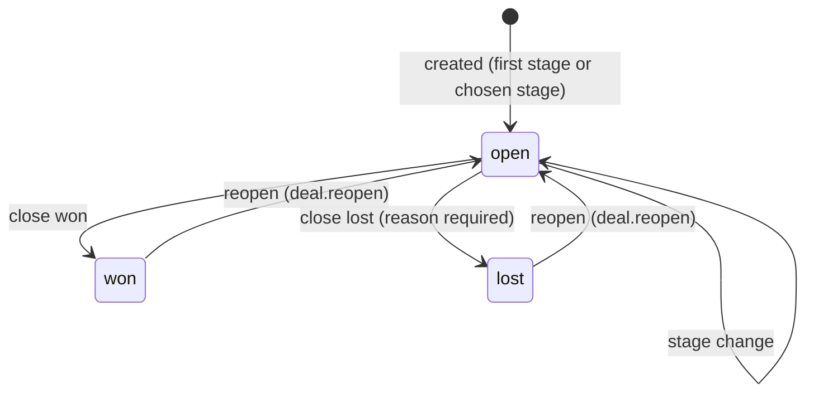

**Dependencies.** F (conversion creates deals), G (account, contact), C/D (owner and scope), M (assignment and stage notifications), N (discount approval, P1), Q.

**APIs.** `GET /pipelines`, `PUT /pipelines/{id}/stages`; `GET|POST /deals`, `GET|PATCH /deals/{id}`, `POST /deals/{id}/move`, `POST /deals/{id}/win`, `POST /deals/{id}/lose`, `POST /deals/{id}/reopen`, `POST /deals/{id}/assign`, `GET /deals/{id}/history`, `GET /deals/board`; `GET|POST /interactions`, `PATCH|DELETE /interactions/{id}`.

**Permissions.** `deal.read`, `deal.create`, `deal.update`, `deal.assign`, `deal.close`, `deal.reopen`, `pipeline.manage`, `interaction.read`, `interaction.create`, `interaction.manage`. "Own" deal = owner is the actor.

**Error cases.** `WIN_REQUIRES_AMOUNT`, `LOST_REASON_REQUIRED`, `DEAL_CLOSED` (409 on edit), `STAGE_IN_USE` (409), `INTERACTION_TARGET_REQUIRED` (422), `EDIT_WINDOW_EXPIRED` (403).

**Acceptance criteria.**
- AC-E1 A deal moved through three stages and won has exactly three `DealStageChange` rows plus one close row, and the account becomes `customer`.
- AC-E2 A sales executive sees only deals they own; a sales manager with `department` scope sees deals of all owners in their department subtree.
- AC-E3 Pipeline board totals per stage equal the sum of open deal amounts in that stage visible to the viewer.

---

## F. Lead management

**Scope.** Capturing, de-duplicating, assigning, working and qualifying leads, and converting them into accounts, contacts and deals.

**Actors.** Sales executive, sales manager, organization admin; public web form (P1).

**Entities.** `Lead`.

**Business rules.**
- F-R1 A lead needs a name and at least one of email or phone. Email is stored lower-cased; phone is normalized to E.164 using the organization's default country.
- F-R2 Duplicate check on create and update: same email or same normalized phone among non-converted leads, contacts of the organization. P0 warns and requires explicit confirmation (`confirmDuplicate=true`); merge is P1.
- F-R3 Source is required, from the `lead_source` picklist.
- F-R4 Every lead has one owner. Unassigned leads are owned by nobody only in the "unassigned queue", visible to `lead.assign` holders. Automatic round-robin assignment rules are P1.
- F-R5 Disqualifying requires a reason from the `lead_disqualify_reason` picklist.
- F-R6 **Conversion** (atomic): creates or links an account (match by name or chosen existing), creates or links a contact, optionally creates a deal in the first stage with the given amount, copies interactions' links, and sets the lead to `converted` with references to the created records. A converted lead is read-only.
- F-R7 CSV import (P1): up to 10,000 rows per file, validated row by row, processed as a background job with a downloadable error report; the whole import is one audit event plus a summary.

**State transitions.**

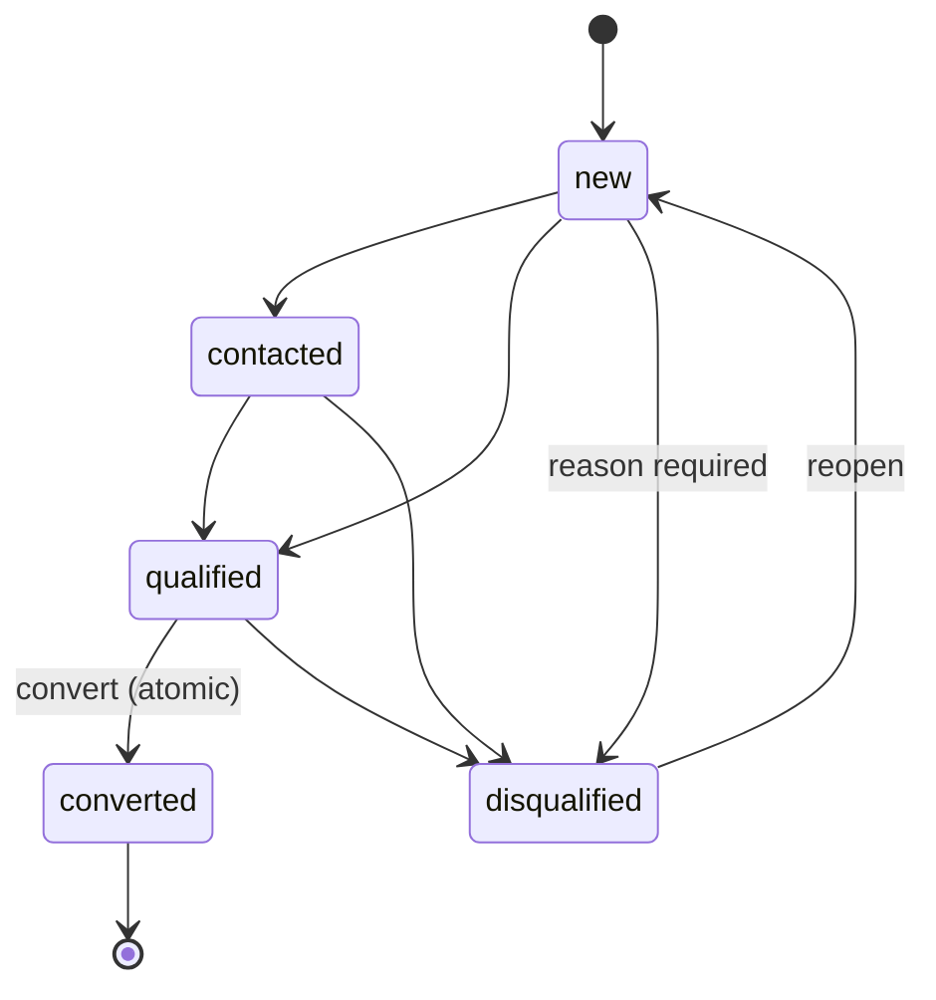

**Dependencies.** G and E (conversion), E (interactions), C/D (owner, scope), M (assignment), Q.

**APIs.** `GET|POST /leads`, `GET|PATCH|DELETE /leads/{id}`, `POST /leads/{id}/assign`, `POST /leads/{id}/status`, `POST /leads/{id}/disqualify`, `POST /leads/{id}/convert`, `GET /leads/duplicates?email=&phone=`; P1: `POST /leads/imports`, `GET /leads/imports/{id}`, `POST /public/{orgSlug}/leads`.

**Permissions.** `lead.read`, `lead.create`, `lead.update`, `lead.assign`, `lead.convert`, `lead.delete`, `lead.import` (P1), `lead.export` (P1). "Own" = owner is the actor.

**Error cases.** `CONTACT_METHOD_REQUIRED`, `POSSIBLE_DUPLICATE` (409 with matches, unless confirmed), `DISQUALIFY_REASON_REQUIRED`, `LEAD_CONVERTED` (409 on edit), `INVALID_TRANSITION`.

**Acceptance criteria.**
- AC-F1 Conversion creates account, contact and deal and marks the lead converted in one transaction; injecting a failure in deal creation leaves no account, contact or status change.
- AC-F2 Creating a lead with the email of an existing contact returns `POSSIBLE_DUPLICATE` listing the contact, and succeeds when confirmed.
- AC-F3 Lead deletion is only possible for `new` or `disqualified` leads with no interactions.

---

## G. Customer management (accounts and contacts)

**Scope.** The companies the organization sells to and the people at them, with a consolidated relationship timeline.

**Actors.** Sales roles, organization admin; read-only for other roles granted `account.read`.

**Entities.** `Account`, `Contact`.

**Business rules.**
- G-R1 Account name unique per organization (case-insensitive) among non-archived accounts; domain (website) optional, used for duplicate hints.
- G-R2 Account `type` is `prospect` or `customer`; becomes `customer` automatically on first won deal (E-R4); can be set to `churned` manually; `churned → customer` on a new won deal.
- G-R3 A contact belongs to at most one account. Contact email unique per organization when present.
- G-R4 Every account has one owner employee (account manager); contacts inherit visibility from their account if they have one, otherwise from their own owner.
- G-R5 An account with open deals cannot be archived.
- G-R6 The account timeline is a read model: interactions, deals, tasks and documents linked to the account or its contacts, ordered by time.

**State transitions.** Account: `prospect → customer → churned → customer`; any → `archived` (if no open deals) → restore. Contact: `active ⇄ archived`.

**Dependencies.** E, F, H (tasks linked to account), L, Q.

**APIs.** `GET|POST /accounts`, `GET|PATCH /accounts/{id}`, `POST /accounts/{id}/archive|restore`, `GET /accounts/{id}/timeline`, `GET /accounts/{id}/contacts`; `GET|POST /contacts`, `GET|PATCH /contacts/{id}`, `POST /contacts/{id}/archive|restore`.

**Permissions.** `account.read`, `account.manage`, `contact.read`, `contact.manage`.

**Error cases.** `DUPLICATE` (409), `HAS_OPEN_DEALS` (422).

**Acceptance criteria.**
- AC-G1 First won deal for a prospect account changes its type to `customer`.
- AC-G2 The timeline returns only items the viewer may read individually.

---

## H. Task and work management

**Scope.** Projects and tasks, including tasks linked to sales and recruitment records, Kanban and list views, comments.

**Actors.** All employees; team leaders and managers assign and review.

**Entities.** `Project`, `ProjectMember`, `Task`, `TaskComment`.

**Business rules.**
- H-R1 Project `key` (2–6 uppercase letters) unique per organization; tasks in a project get keys `KEY-n` from a per-project counter. Tasks without a project get `TASK-n`.
- H-R2 A task has a title, optional description (Markdown, sanitized on render), status, priority (`low`, `medium`, `high`, `urgent`), optional due date, one assignee employee (optional), one reporter (creator).
- H-R3 A task may link to at most one of: lead, deal, account, application (enforced by check constraint).
- H-R4 Subtasks: one level only (`parent_task_id` whose parent has no parent). A parent cannot be `done` while subtasks are open unless they are cancelled together (explicit flag).
- H-R5 Project visibility: members of the project, plus anyone with `project.read` at organization scope. Tasks without a project follow assignee/reporter scope.
- H-R6 Assigning a task to an employee outside the actor's `task.assign` scope is forbidden.
- H-R7 `completed_at` is set when entering `done` and cleared when leaving it.
- H-R8 Comments support @mentions of employees who can see the task; mentions trigger notifications. Comments are editable by their author for 24 hours; deletion leaves a "comment deleted" marker.
- H-R9 Recurring tasks, dependencies, time tracking and Gantt views are P2.

**State transitions.**

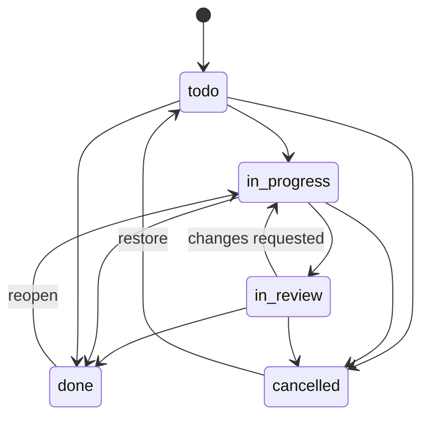

Project: `planned → active ⇄ on_hold → completed → archived`.

**Dependencies.** C/D (assignee and scope), E/F/G/J (linked records; linked record visibility is checked via owning domain's service), M, L, Q.

**APIs.** `GET|POST /projects`, `GET|PATCH /projects/{id}`, `POST /projects/{id}/status`, `GET|POST /projects/{id}/members`, `DELETE /projects/{id}/members/{employeeId}`; `GET|POST /tasks`, `GET|PATCH|DELETE /tasks/{id}`, `POST /tasks/{id}/status`, `POST /tasks/{id}/assign`, `GET /tasks/board`, `GET /me/tasks`; `GET|POST /tasks/{id}/comments`, `PATCH|DELETE /tasks/{id}/comments/{commentId}`.

**Permissions.** `project.read`, `project.manage`, `task.read`, `task.create`, `task.update`, `task.assign`, `task.delete`. "Own" task = actor is assignee or reporter.

**Error cases.** `SUBTASK_DEPTH`, `OPEN_SUBTASKS` (422), `ASSIGNEE_OUT_OF_SCOPE` (403), `MULTIPLE_LINKS` (422), `INVALID_TRANSITION`.

**Acceptance criteria.**
- AC-H1 An employee sees tasks assigned to or reported by them, and project tasks of projects they are members of — nothing else unless granted broader scope.
- AC-H2 Mentioning an employee who cannot see the task is rejected with 422 `MENTION_NOT_VISIBLE`.
- AC-H3 A task linked to a lead the viewer cannot read shows the link as "restricted record" without leaking its name.

---

## I. Employee activity and daily reports

**Scope.** Employees' own end-of-day reports of work done, with time entries, and manager review. **Automatic monitoring (screenshots, keystrokes, browser tracking) is out of scope by product decision** (privacy, legal exposure and trust).

**Actors.** Employee (writes own), reporting manager / team leader (reviews), HR and department head (read within scope).

**Entities.** `DailyReport`, `DailyReportEntry`.

**Business rules.**
- I-R1 At most one report per employee per calendar date (organization time zone).
- I-R2 An entry has a description (≤ 1,000 characters), duration in minutes (5–720, multiple of 5), optional category (`daily_report_category` picklist), optional link to a task or project.
- I-R3 Total duration per report ≤ 1,440 minutes.
- I-R4 A report can be submitted for today or up to 7 days back; submissions after the organization's cutoff (default 10:00 the next working day) are flagged `late`.
- I-R5 The reviewer is the employee's reporting manager; if none, the leader of their primary team; if none, the department head. Resolved at submission and stored.
- I-R6 Reviewer can mark `reviewed` (optional comment) or `returned` (comment required). A returned report is editable and resubmittable. Reviewed reports are immutable.
- I-R7 A reminder notification is sent at a configurable time (default 18:00 local) on working days to employees without a submitted report for that day.
- I-R8 P1: suggest entries from tasks the employee moved that day.

**State transitions.**

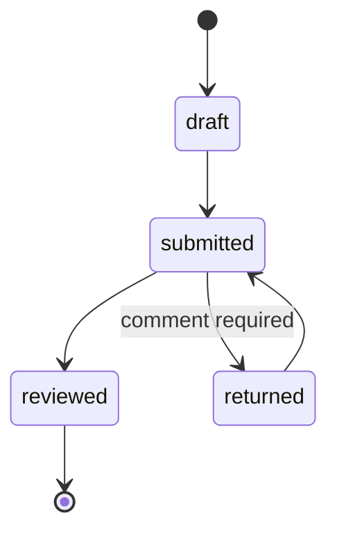

**Dependencies.** C/D (reviewer resolution, scope), H (linked tasks), M (reminders, returned notifications), Q.

**APIs.** `GET /me/daily-reports`, `PUT /me/daily-reports/{date}` (create or update draft), `POST /me/daily-reports/{date}/submit`; `GET /daily-reports` (filters: employee, team, date range, status), `GET /daily-reports/{id}`, `POST /daily-reports/{id}/review`, `POST /daily-reports/{id}/return`; `GET /daily-reports/compliance?from=&to=` (submission rate per employee).

**Permissions.** `daily_report.read`, `daily_report.review`. Writing one's own report requires only an active employee-linked membership.

**Error cases.** `REPORT_EXISTS` (409), `DATE_OUT_OF_RANGE` (422), `DURATION_EXCEEDED` (422), `REPORT_LOCKED` (409), `RETURN_COMMENT_REQUIRED` (422).

**Acceptance criteria.**
- AC-I1 Submitting at 10:01 next working day sets `late=true`.
- AC-I2 A returned report shows the comment to the author and becomes editable; a reviewed one rejects edits with `REPORT_LOCKED`.
- AC-I3 The reminder job sends exactly one reminder per employee per day and none on non-working days.

---

## J. Recruitment and applicant tracking (R2)

**Scope.** Job openings, candidates, applications through hiring stages, interviews and feedback, offers, and hire-to-employee conversion.

**Actors.** Recruiter, HR manager, hiring manager (an employee named on the opening), interviewers, department head (approves openings).

**Entities.** `JobOpening`, `HiringStage`, `Candidate`, `Application`, `ApplicationStageChange`, `Interview`, `InterviewParticipant`, `InterviewFeedback`, `Offer`.

**Business rules.**
- J-R1 A job opening has title, department, hiring manager, number of openings (≥ 1), employment type, location, internal description, optional public description, optional salary range (visible only with `compensation.read`).
- J-R2 Opening a job (`draft → open`) requires an approved approval request when the organization has a policy for `job_opening.open` (domain N); otherwise it opens directly.
- J-R3 Hiring stages per organization: ordered stages each mapped to one fixed category: `applied`, `screening`, `interview`, `offer`, `hired`. Outcomes `rejected` and `withdrawn` are fixed.
- J-R4 Candidate email unique per organization; creating a candidate with an existing email links to the existing candidate (dedupe).
- J-R5 One non-closed application per candidate per job opening.
- J-R6 Rejecting requires a reason (`application_reject_reason` picklist). Rejection emails to candidates are sent only if the recruiter chooses to, with a template.
- J-R7 Moving to the `hired` category requires an accepted offer.
- J-R8 Interviews have one or more interviewers. An interviewer sees the candidate profile, resume and the application they interview for — not compensation, not other interviewers' feedback until they have submitted their own (P1 for the hide rule; P0 shows all feedback to `interview.feedback.read` holders only).
- J-R9 Feedback: rating 1–5, recommendation (`strong_no`, `no`, `yes`, `strong_yes`), notes; editable by its author until the application reaches `offer` or is closed.
- J-R10 Offers: compensation, joining date, expiry date; release to the candidate requires approval when a policy for `offer.release` exists. Only one non-terminal offer per application.
- J-R11 **Hire** (atomic): application → `hired` stage; employee created in `pre_joining` with name, email, phone, department, manager (hiring manager), job title, join date from the offer; candidate documents marked for the employee are linked to the employee; opening's `filled_count` incremented; when `filled_count = openings`, the opening is proposed for closing.
- J-R12 AI must never rank or reject candidates automatically (see domain P).
- J-R13 Candidate data retention: see [DATABASE.md](DATABASE.md) §9.

**State transitions.**

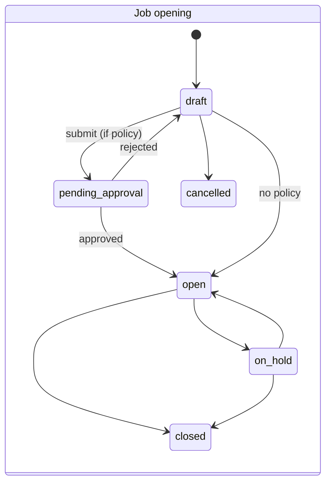

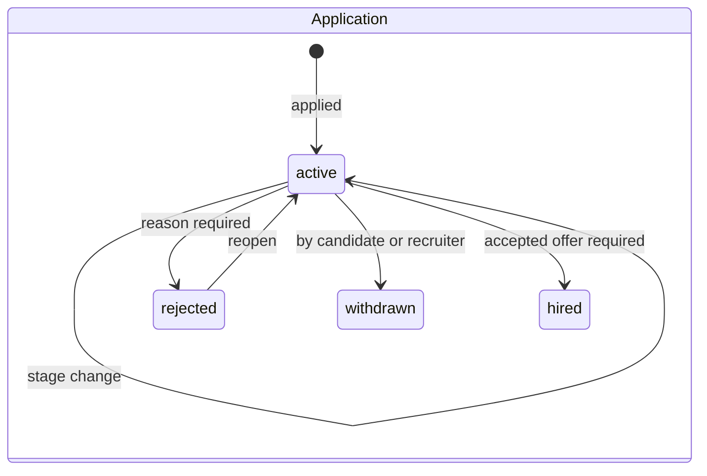

Offer: `draft → pending_approval → approved → sent → accepted | declined | expired`; `approved|sent → revoked`. Interview: `scheduled → completed | cancelled | no_show`.

**Dependencies.** N (approvals), C (hire), D (department), K (portal applications), L (resumes, offer letters), M, Q.

**APIs.** `GET|POST /job-openings`, `GET|PATCH /job-openings/{id}`, `POST /job-openings/{id}/submit|open|hold|close|cancel|publish|unpublish`; `GET|PUT /hiring-stages`; `GET|POST /candidates`, `GET|PATCH /candidates/{id}`; `GET|POST /applications`, `GET /applications/{id}`, `POST /applications/{id}/move|reject|withdraw|reopen|hire`, `GET /job-openings/{id}/board`; `GET|POST /interviews`, `PATCH /interviews/{id}`, `POST /interviews/{id}/cancel|complete`, `PUT /interviews/{id}/feedback`; `GET|POST /offers`, `PATCH /offers/{id}`, `POST /offers/{id}/submit|send|revoke|record-response`.

**Permissions.** `job.read`, `job.manage`, `job.publish`, `candidate.read`, `candidate.manage`, `application.read`, `application.move`, `application.reject`, `interview.schedule`, `interview.feedback.read`, `offer.read`, `offer.manage`, `compensation.read`, `hire.complete`. Interviewer access is assignment-based (participant on an interview), not role-based.

**Error cases.** `APPROVAL_REQUIRED` (409), `DUPLICATE_APPLICATION` (409), `REJECT_REASON_REQUIRED`, `OFFER_NOT_ACCEPTED` (422 on hire), `OFFER_EXISTS` (409), `OPENING_NOT_OPEN` (409).

**Acceptance criteria.**
- AC-J1 Hire creates the employee, links documents, increments `filled_count` and closes the application in one transaction; simulated failure leaves nothing changed.
- AC-J2 An interviewer cannot read compensation fields or applications they are not assigned to (404).
- AC-J3 With an `offer.release` policy configured, `send` on an unapproved offer fails with `APPROVAL_REQUIRED`.

---

## K. Candidate portal (R2)

**Scope.** Public careers page per organization, application submission, candidate self-service.

**Actors.** Anonymous visitor, candidate (authenticated with a candidate account).

**Entities.** `CandidateAccount` (owned by A), uses J's `Candidate`, `Application`, `Offer` through J's service; `ConsentRecord`.

**Business rules.**
- K-R1 Careers page at `/careers/{orgSlug}` lists only `open` and published job openings with their public description.
- K-R2 Applying requires email verification (one-time code) which also creates or signs into the candidate account; spam protection by rate limit (5 applications per hour per IP, 20 per day per email) and a CAPTCHA challenge.
- K-R3 Resume upload: PDF, DOC, DOCX; ≤ 10 MB; malware-scanned before recruiters can download it.
- K-R4 The candidate sees only: their applications, a candidate-facing status label per stage category (`Application received`, `Under review`, `Interviewing`, `Offer`, `Hired`, `Not selected`, `Withdrawn`), interview times, offers sent to them, documents they uploaded. Internal notes, feedback, ratings, stage names, compensation ranges and rejection reasons are never exposed.
- K-R5 The candidate can withdraw an application, upload requested documents, accept or decline an offer (P1), update contact details, download their data and request deletion.
- K-R6 Consent to the organization's privacy notice is recorded with version and timestamp before submission; the candidate can opt in to being considered for future openings (affects retention).

**State transitions.** Candidate-facing status is derived from the application (no own state).

**Dependencies.** A (candidate auth), J, L, M (emails), Q.

**APIs.** `GET /portal/{orgSlug}/jobs`, `GET /portal/{orgSlug}/jobs/{jobSlug}`, `POST /portal/{orgSlug}/applications`; authenticated: `GET /portal/me`, `PATCH /portal/me`, `GET /portal/me/applications`, `POST /portal/me/applications/{id}/withdraw`, `POST /portal/me/documents`, `POST /portal/me/offers/{id}/accept|decline` (P1), `POST /portal/me/data-export`, `POST /portal/me/deletion-request`.

**Permissions.** Candidate principal only; fixed, not configurable.

**Error cases.** `JOB_NOT_AVAILABLE` (404), `ALREADY_APPLIED` (409), `CODE_INVALID` / `CODE_EXPIRED` (401), `FILE_TYPE_NOT_ALLOWED` / `FILE_TOO_LARGE` (422), `RATE_LIMITED`.

**Acceptance criteria.**
- AC-K1 A candidate of organization A cannot see organization B's data even with a valid session and guessed IDs.
- AC-K2 Response bodies of portal endpoints contain none of: feedback, rating, internal stage name, rejection reason, salary range (verified by schema tests).
- AC-K3 An application cannot be submitted before email verification.

---

## L. Documents and attachments

**Scope.** Secure upload, storage, scanning, classification and access control of files attached to business records.

**Actors.** Any user within the permissions of the parent record; candidates for their own uploads.

**Entities.** `Document`, `DocumentLink`.

**Business rules.**
- L-R1 Files are stored in a private bucket under a generated key `org/{orgId}/{documentId}`; original filename is metadata only.
- L-R2 Upload flow: request upload (metadata, size, type) → presigned PUT URL (5 minutes) → client uploads → complete call → server verifies size, SHA-256 and detected content type → status `scanning` → malware scan → `available` or `quarantined`.
- L-R3 Allowed types: PDF, PNG, JPEG, WEBP, DOCX, XLSX, PPTX, TXT, CSV; maximum 25 MB (10 MB for candidate uploads). Executables and archives are refused.
- L-R4 A document is linked to one or more records through `DocumentLink(entity_type, entity_id)`. Access requires read access to at least one linked record, **checked by the owning domain's policy**, and classification clearance: `general` (record access suffices), `confidential` (record access suffices, but excluded from exports and email), `restricted` (also requires `document.restricted.read`, e.g. offer letters, ID proofs).
- L-R5 Downloads are via presigned GET URLs valid 60 seconds, served with `Content-Disposition: attachment`, after a permission check that is audited for `restricted` documents.
- L-R6 Deleting a document soft-deletes it (hidden, retained 30 days for recovery), then the object is purged. Documents under retention hold cannot be purged.
- L-R7 Versioning and an organization document library with folders are P1.
- L-R8 Per-organization storage quota (default 50 GB, P2 enforcement).

Allowed `entity_type` values: `employee`, `candidate`, `application`, `offer`, `lead`, `account`, `contact`, `deal`, `task`, `project`, `approval_request`.

**State transitions.** `pending_upload → scanning → available | quarantined`; `available → deleted → purged`. Pending uploads not completed within 1 hour are purged.

**Dependencies.** Owning domains' policies (via a `canRead(entityType, entityId, actor)` registry), Q, object storage, scanner.

**APIs.** `POST /documents/uploads` (returns upload URL), `POST /documents/{id}/complete`, `GET /documents?entityType=&entityId=`, `GET /documents/{id}`, `POST /documents/{id}/download` (returns short-lived URL), `PATCH /documents/{id}` (name, classification), `DELETE /documents/{id}`, `POST /documents/{id}/links`, `DELETE /documents/{id}/links/{linkId}`.

**Permissions.** `document.read`, `document.upload`, `document.delete`, `document.restricted.read`, plus parent-record access (L-R4).

**Error cases.** `FILE_TYPE_NOT_ALLOWED`, `FILE_TOO_LARGE`, `UPLOAD_INCOMPLETE` (409), `CHECKSUM_MISMATCH` (422), `DOCUMENT_QUARANTINED` (409 on download), `DOCUMENT_NOT_READY` (409).

**Acceptance criteria.**
- AC-L1 A file with a `.pdf` name but executable content is refused at `complete`.
- AC-L2 A quarantined or still-scanning document cannot be downloaded.
- AC-L3 A download URL expires after 60 seconds (request at 61 s fails).
- AC-L4 Loss of access to every linked record removes access to the document.

---

## M. Notifications

**Scope.** Delivering in-app and email notifications triggered by domain events, read state, preferences.

**Actors.** All users and candidates (email only).

**Entities.** `Notification`, `NotificationPreference` (P1), `EmailDelivery`.

**Business rules.**
- M-R1 Notifications are created by consumers of domain events from the outbox, never inline in the business transaction.
- M-R2 A notification is only created for a recipient who can read the referenced record at creation time; when opened later, access is checked again.
- M-R3 Email bodies contain no `confidential` or `restricted` data and no record details beyond a title; they link to the app.
- M-R4 Security notifications (password changed, new sign-in from new device, MFA changed, invitation) are mandatory and cannot be turned off.
- M-R5 Idempotency: one notification per (event ID, recipient).
- M-R6 Email delivery retries 5 times with exponential backoff; hard bounces mark the address as undeliverable for 30 days.
- M-R7 Read notifications are deleted after 90 days; unread after 180 days.
- M-R8 Preferences per notification type and channel, daily digest (P1). Push, SMS, WhatsApp (P2).

Initial notification catalog (P0): `task.assigned`, `task.due_soon` (24 h), `task.overdue`, `task.mentioned`, `lead.assigned`, `deal.assigned`, `deal.won`, `daily_report.reminder`, `daily_report.returned`, `daily_report.submitted` (to reviewer, digest), `member.invited`, `security.*`. R2: `approval.requested`, `approval.decided`, `application.received`, `interview.scheduled`, `interview.feedback_due`, `offer.responded`.

**State transitions.** Notification: `unread → read`. Email delivery: `queued → sent → delivered | bounced | failed`.

**Dependencies.** All event-producing domains, email provider, A (recipient resolution).

**APIs.** `GET /notifications` (unread filter, cursor), `GET /notifications/unread-count`, `POST /notifications/{id}/read`, `POST /notifications/read-all`; P1 `GET|PUT /me/notification-preferences`. Real-time delivery via server-sent events `GET /notifications/stream` (P1; P0 polls every 60 s).

**Permissions.** Own notifications only (no grantable permission).

**Error cases.** None beyond common.

**Acceptance criteria.**
- AC-M1 Assigning a task produces exactly one in-app notification and one email to the assignee even if the event is delivered twice.
- AC-M2 No notification is created when the business transaction rolls back.
- AC-M3 An email for a restricted document contains no file name or record name.

---

## N. Approval and workflow engine (R2)

**Scope.** A generic, configurable multi-step approval service used by other domains. It decides *whether* something is approved; the owning domain applies the change.

**Actors.** Requester (any employee), approvers, organization admin (configures policies).

**Entities.** `ApprovalPolicy`, `ApprovalRequest`, `ApprovalStep`.

**Business rules.**
- N-R1 Request types are registered by domains in code: `job_opening.open`, `offer.release` (R2), `deal.discount` (P1 / R2). Organizations configure policies for registered types only.
- N-R2 A policy has optional conditions (e.g. `amount > X`, `department in [...]`) and 1–5 sequential steps. Approver resolution per step: specific employee, requester's manager, head of the subject's department, or any holder of a role.
- N-R3 The full policy is snapshotted into the request at submission; later policy changes do not affect in-flight requests.
- N-R4 A requester can never approve their own request; a step whose resolved approver is the requester escalates to the next resolution rule (manager's manager), recorded in the step.
- N-R5 Approvers' authority is re-checked at decision time (still active, still holds role).
- N-R6 Rejection requires a comment and ends the request. Approval of the last step approves the request and emits `approval.approved` with the subject reference; the owning domain applies the change via its event handler.
- N-R7 While a request is pending, the owning domain blocks edits to the fields under approval (e.g. offer compensation).
- N-R8 The requester can cancel a pending request. Pending steps send reminders after 48 hours (configurable).
- N-R9 Parallel steps, delegation (out-of-office) and SLA escalation are P1/P2.

**State transitions.**

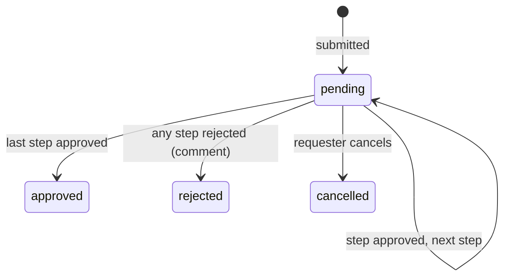

Step: `waiting → pending → approved | rejected | skipped`.

**Dependencies.** C/D (approver resolution), owning domains (J, E), M, Q.

**APIs.** `GET|POST /approval-policies`, `GET|PATCH|DELETE /approval-policies/{id}`; `GET /approval-requests` (filters: mine, awaiting-me, status), `GET /approval-requests/{id}`, `POST /approval-requests/{id}/approve|reject|cancel`. Requests are created by owning domains' endpoints, not directly.

**Permissions.** `approval.policy.manage`, `approval.request.read` (organization-wide view); approving is assignment-based.

**Error cases.** `NOT_CURRENT_APPROVER` (403), `APPROVER_INACTIVE` (409, step re-resolved), `REQUEST_CLOSED` (409), `COMMENT_REQUIRED` (422), `UNKNOWN_REQUEST_TYPE` (422).

**Acceptance criteria.**
- AC-N1 A two-step request approved by step 1 and rejected at step 2 ends `rejected`; the subject is unchanged.
- AC-N2 Changing a policy after submission does not alter the steps of an existing request.
- AC-N3 A requester who is also the resolved approver is skipped to the next resolution and the substitution is recorded.

---

## O. Business intelligence

**Scope.** Defined metrics, role-based dashboards, exports, scheduled reports.

**Actors.** All roles, each seeing only data within their scope; executives and owners.

**Entities.** `MetricDefinition` (code-defined catalog with documented formula), `ReportExport` (P1), `ScheduledReport` (P2).

**Business rules.**
- O-R1 Every metric has one written definition (formula, filters, time basis, time zone) in [SRS.md](SRS.md) §6 and a test against fixture data with a known answer.
- O-R2 Metrics are computed with the same scope rules as the underlying records: a team leader's "overdue tasks" counts only tasks they could open.
- O-R3 Dashboard widgets show their data freshness; cached values are at most 5 minutes old.
- O-R4 Exports (CSV, P1) run as background jobs, are limited to 100,000 rows, exclude `confidential`/`restricted` fields unless the requester holds the corresponding permissions, are audited, and the file link expires after 24 hours.
- O-R5 Custom report builder and scheduled email reports are P2.

**Dependencies.** Read services of C, D, E, F, H, I, J; Q (export audit); L (export files).

**APIs.** `GET /dashboards/{dashboardKey}` (key per role), `GET /metrics/{metricKey}?from=&to=&groupBy=&scope=`; P1 `POST /exports`, `GET /exports/{id}`.

**Permissions.** `report.sales.read`, `report.people.read`, `report.work.read`, `report.recruitment.read`, `report.export` (P1).

**Error cases.** `RANGE_TOO_LARGE` (422, > 2 years at day grain), `EXPORT_TOO_LARGE` (422).

**Acceptance criteria.**
- AC-O1 Each P0 metric returns the documented value for the reference fixture.
- AC-O2 The same metric requested by a team leader and an admin differs exactly by out-of-scope records.

---

## P. AI assistance (R3)

**Scope.** Assistive features: summarize a record, draft text, answer questions about data the user can already see. Detailed design in Phase 8.

**Actors.** Users of organizations that enabled AI.

**Entities.** `AiConversation`, `AiMessage`, `AiToolCall`; organization AI settings.

**Business rules.**
- P-R1 Disabled by default; enabled per organization by the owner after accepting the AI data-processing terms.
- P-R2 The assistant acts only through domain services under the requesting user's identity and scope (ADR-010). No direct database access, no elevated role.
- P-R3 Any write (create task, update lead, draft email send) requires explicit user confirmation in the UI and is audited as performed by the user with `via=ai`.
- P-R4 Content from records (lead notes, resumes, emails) is treated as untrusted data and cannot change the assistant's instructions; tool permissions do not depend on model output.
- P-R5 **No automated decisions about people**: AI never ranks, scores, shortlists or rejects candidates or employees. Summaries of resumes are allowed and labelled as AI-generated.
- P-R6 Customer data is not used to train models; provider contracts must guarantee zero retention or equivalent.
- P-R7 Conversations retained 30 days by default, then deleted.

**Candidate features (R3).** Record summary (lead, deal, account, candidate), draft email reply, draft job description, draft daily report from today's tasks, natural-language questions over own-scope data ("Which of my deals close this month?").

**Dependencies.** All domain read services; Q; model provider (selected in Phase 8).

**APIs.** `POST /ai/conversations`, `POST /ai/conversations/{id}/messages` (streamed), `POST /ai/actions/{id}/confirm`, `GET /ai/conversations`, `DELETE /ai/conversations/{id}`.

**Permissions.** `ai.assistant.use`, `ai.settings.manage`.

**Acceptance criteria (Phase 8).** Cross-scope and cross-tenant leakage tests pass; prompt-injection test set passes; every write required confirmation.

---

## Q. Audit and governance

**Scope.** Immutable audit trail, security event log, data retention enforcement, data-subject requests, platform-operator access log.

**Actors.** Organization owner/admin (`audit.read`), platform operators (platform audit), compliance officer role (custom).

**Entities.** `AuditEvent` (tenant), `PlatformAuditEvent` (platform), `RetentionPolicy` (system defaults + org overrides), `DataSubjectRequest` (P1), `OutboxEvent` (technical, owned here as the event backbone).

**Business rules.**
- Q-R1 Audited actions write an audit event in the same transaction (ADR-007). The catalog of audited actions is in [SECURITY.md](SECURITY.md) §6.
- Q-R2 Audit events cannot be updated or deleted through the application (database grants enforce this).
- Q-R3 Sensitive values (passwords, tokens, government IDs, compensation) are never written to audit diffs; their field names are recorded with `"[REDACTED]"`.
- Q-R4 Audit events are retained 2 years online, then archived (cold storage) up to 7 years, unless the organization's legal requirements dictate otherwise (to be confirmed — PRD Q5).
- Q-R5 Every platform-operator access to a tenant (support access, P1) is recorded both in the platform audit and in the tenant's audit log, visible to the owner.
- Q-R6 Data-subject requests (export, rectification, erasure) are tracked with due dates (default 30 days); erasure anonymizes personal fields while preserving referential and audit integrity.

**APIs.** `GET /audit-events` (filters: actor, action, target type/ID, date range), `GET /audit-events/{id}`; P1 `GET|POST /data-requests`, `POST /data-requests/{id}/complete`; platform: `GET /platform/audit-events`.

**Permissions.** `audit.read`, `data_request.manage`.

**Acceptance criteria.**
- AC-Q1 An `UPDATE` or `DELETE` on `audit_events` executed as the application database role fails.
- AC-Q2 Rolling back a business transaction leaves no audit event for it.
- AC-Q3 Changing an employee's government ID writes an audit event whose diff contains `"[REDACTED]"`, not the value.
